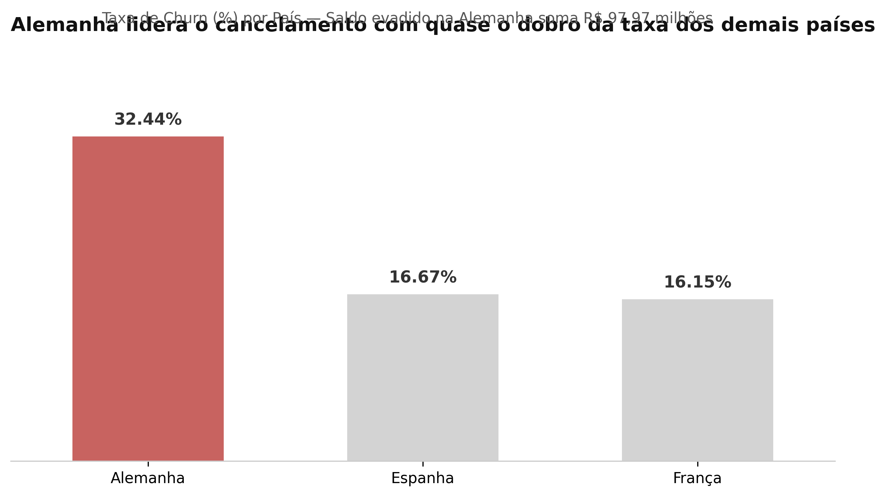
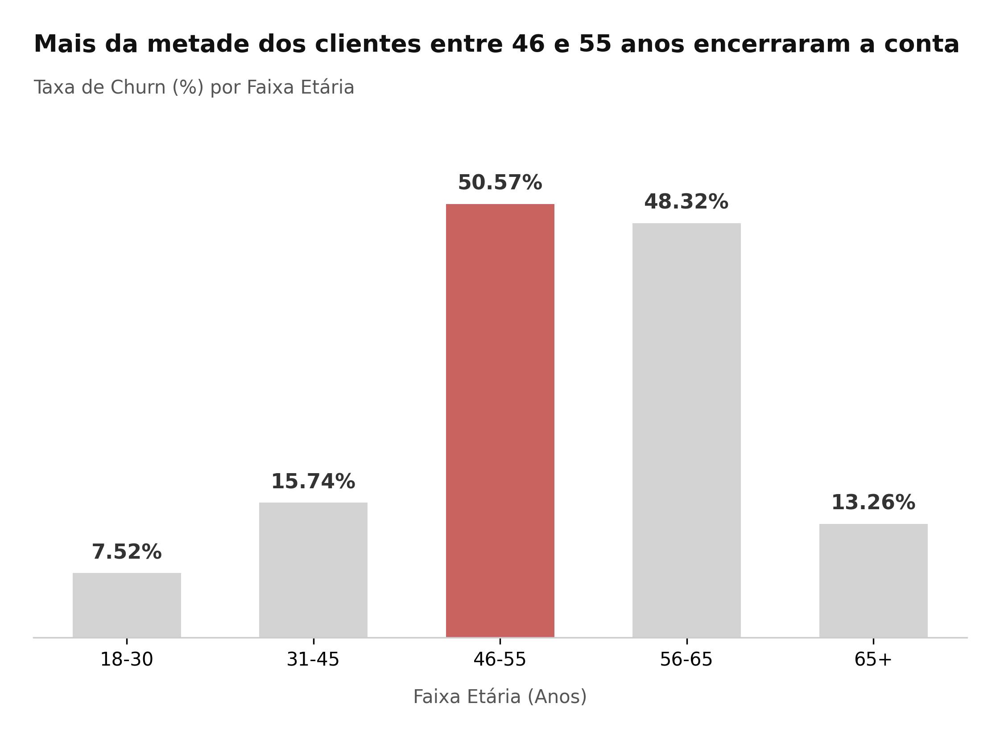
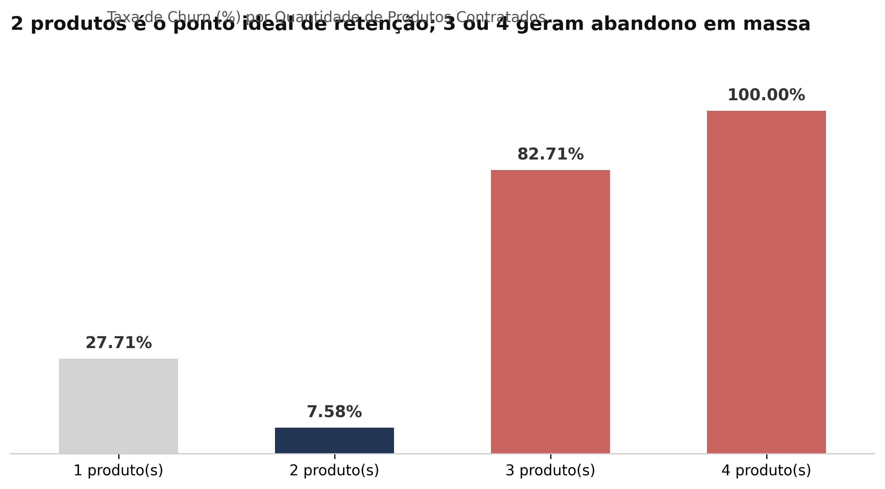
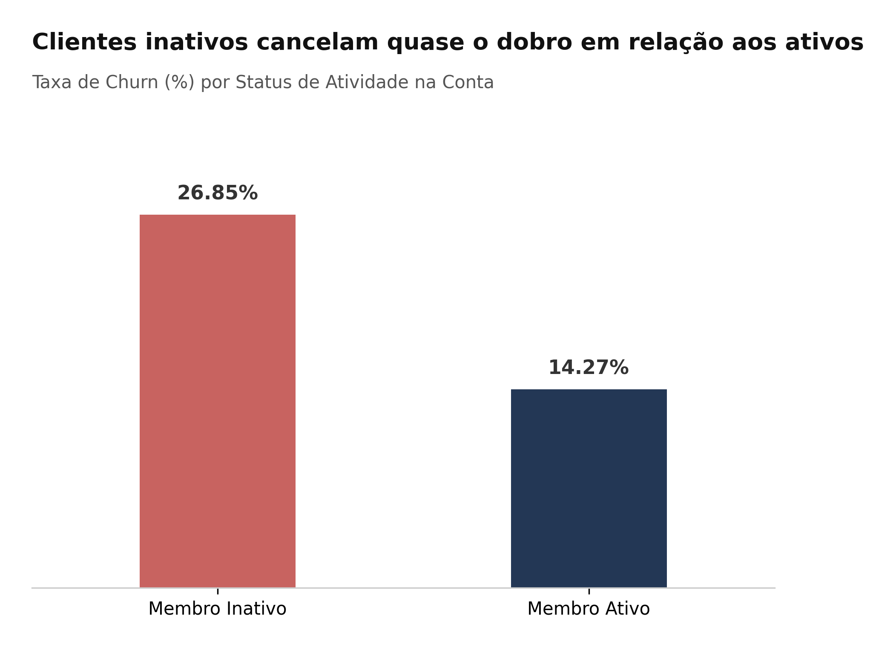

# Análise de Retenção e Churn Bancário (Bank Customer Churn)

*[Read in English below](#bank-customer-churn-analysis-english)*

## 1. Contexto de Negócio
Uma instituição financeira identificou aumento no encerramento de contas apesar do ritmo positivo de aquisição de novos clientes. O objetivo desta análise exploratória foi diagnosticar o tamanho real da evasão, identificar o perfil demográfico e comportamental dos clientes que cancelam e propor ações práticas de retenção para a diretoria.

- **Base de dados:** 10.000 registros de clientes (Kaggle — *Bank Customer Churn*).
- **Ferramentas utilizadas:** Python (Pandas, Matplotlib, Seaborn) no Google Colab.
- **Privacidade e Limpeza:** Remoção de identificadores pessoais (`Surname`, `CustomerId`, `RowNumber`) em conformidade com boas práticas de privacidade (LGPD/GDPR), validação de duplicidades e verificação de integridade dos dados.

---

## 2. Principais Descobertas

- **Taxa Geral e Impacto Financeiro:** O banco perdeu **20,37%** da base (2.037 clientes). Clientes que saíram possuíam saldo médio **25,2% superior** ao dos que ficaram (R$ 91.108,54 contra R$ 72.745,30), enquanto o salário estimado permaneceu praticamente idêntico (~R$ 101 mil vs. ~R$ 99,7 mil) — indicando fuga de capital e não falta de poder aquisitivo.
- **Concentração Geográfica:** A **Alemanha** lidera a evasão com **32,44%** de churn (quase o dobro de França e Espanha) e concentra **R$ 97,97 milhões** em saldo evadido.
- **Recorte Demográfico:** Clientes entre **46 e 55 anos** apresentam taxa crítica de **50,57%** de cancelamento. No recorte por gênero, mulheres cancelam mais que homens (**25,07%** vs. **16,46%**).
- **Ponto Ótimo de Produtos:** Clientes com **2 produtos** têm a menor taxa de saída da base (**7,58%**). A partir de 3 produtos o cancelamento dispara para **82,71%**, chegando a **100%** entre clientes com 4 produtos.
- **Engajamento vs. Tempo de Casa:** O tempo de relacionamento (`Tenure`) e a posse de cartão de crédito (`HasCrCard`) não alteram significativamente a retenção. Já o status de atividade é determinante: membros inativos cancelam quase o dobro dos ativos (**26,85%** vs. **14,27%**).

---

## 3. Visualizações

### Geografia e Impacto Financeiro

### Perfil Etário

### Uso de Produtos

### Engajamento

---

## 4. Plano de Ação Recomendado

### 1. Limitar o cross-sell a 2 produtos e auditar contas com 3 ou mais
- **Evidência:** Clientes com 2 produtos registram apenas 7,58% de churn, enquanto pacotes com 3 ou 4 produtos geram abandono de 82,71% a 100%.
- **Ação:** Suspender temporariamente a oferta comercial de um terceiro produto na base atual e auditar tarifas, cobranças e jornada de uso dos clientes que já possuem 3 ou 4 produtos ativos.
- **Meta:** Estabilizar o portfólio no ponto ótimo de 2 produtos por cliente.

### 2. Criar frente de retenção dedicada para a Alemanha e público de 46 a 55 anos
- **Evidência:** A Alemanha responde por 32,44% de churn e R$ 97,97 milhões em saldo evadido, com evasão de 50,57% na faixa de 46 a 55 anos e maior incidência entre mulheres (25,07%).
- **Ação:** Priorizar atendimento consultivo e revisão de proposta de valor para correntistas alemães com saldo elevado, desenhando ofertas específicas para o público de 46 a 55 anos e o segmento feminino.
- **Meta:** Reduzir o churn da operação alemã para o patamar médio dos demais países (~16%).

### 3. Implementar gatilhos de ativação para clientes inativos
- **Evidência:** O tempo de casa não retém o cliente (~20% de saída entre novos e antigos), mas membros inativos cancelam quase o dobro dos ativos (26,85% vs. 14,27%).
- **Ação:** Estruturar alertas e incentivos de movimentação mensal nos primeiros 60 dias de inatividade, antes do encerramento da conta.
- **Meta:** Converter clientes inativos em ativos recorrentes, aproximando a evasão desse grupo da média de 14,27%.

---

## 5. Estrutura do Repositório
- `analise_churn_bancario (1).ipynb`: Notebook completo com limpeza, análise exploratória e geração dos gráficos.
- `1_churn_por_pais.png` a `4_churn_engajamento.png`: Visualizações exportadas em alta resolução.

---
---

# Bank Customer Churn Analysis (English)

## 1. Business Context
A retail bank observed a rise in account closures despite steady customer acquisition. This exploratory data analysis (EDA) aimed to quantify customer attrition, identify demographic and behavioral churn drivers, and deliver an actionable retention plan to leadership.

- **Dataset:** 10,000 customer records (Kaggle — *Bank Customer Churn*).
- **Tools:** Python (Pandas, Matplotlib, Seaborn) via Google Colab.
- **Data Cleaning & Privacy:** Removed personally identifiable information (`Surname`, `CustomerId`, `RowNumber`) following data privacy best practices (GDPR/LGPD), checked for duplicates, and validated data integrity.

## 2. Key Findings
- **Overall Churn & Capital Outflow:** Overall churn reached **20.37%** (2,037 customers). Churned customers held an average balance **25.2% higher** than retained ones ($91,108.54 vs. $72,745.30), while estimated salaries remained virtually identical (~$101k vs. ~$99.7k), pointing to value-proposition friction rather than purchasing power.
- **Geographic Concentration:** **Germany** recorded the highest churn rate at **32.44%** (nearly double France and Spain), accounting for **$97.97M** in lost deposits.
- **Demographic Profile:** Customers aged **46–55** experienced a **50.57%** churn rate. Female customers churned at a higher rate than male customers (**25.07%** vs. **16.46%**).
- **Product Sweet Spot:** Customers holding **2 products** showed the lowest churn (**7.58%**). Churn surged to **82.71%** for 3 products and **100%** for 4 products.
- **Engagement vs. Tenure:** Tenure and credit card ownership showed minimal impact on retention, whereas active membership cut churn nearly in half (**14.27%** for active vs. **26.85%** for inactive members).

## 3. Recommended Action Plan
1. **Cap Cross-Selling at 2 Products & Audit 3+ Product Accounts:** Pause aggressive cross-selling beyond 2 products (7.58% churn) and audit fee structures and user friction for customers holding 3–4 products (82.71%–100% churn).
2. **Launch a High-Value Retention Task Force in Germany (Ages 46–55):** Deploy dedicated relationship management and tailored benefits for high-balance German accounts, prioritizing the 46–55 age bracket (50.57% churn) and female segment (25.07% churn) to curb the $97.97M deposit outflow.
3. **Deploy Early Reactivation Triggers for Inactive Accounts:** Trigger automated engagement incentives after 60 days of inactivity to convert inactive members (26.85% churn) into active users (14.27% churn).
